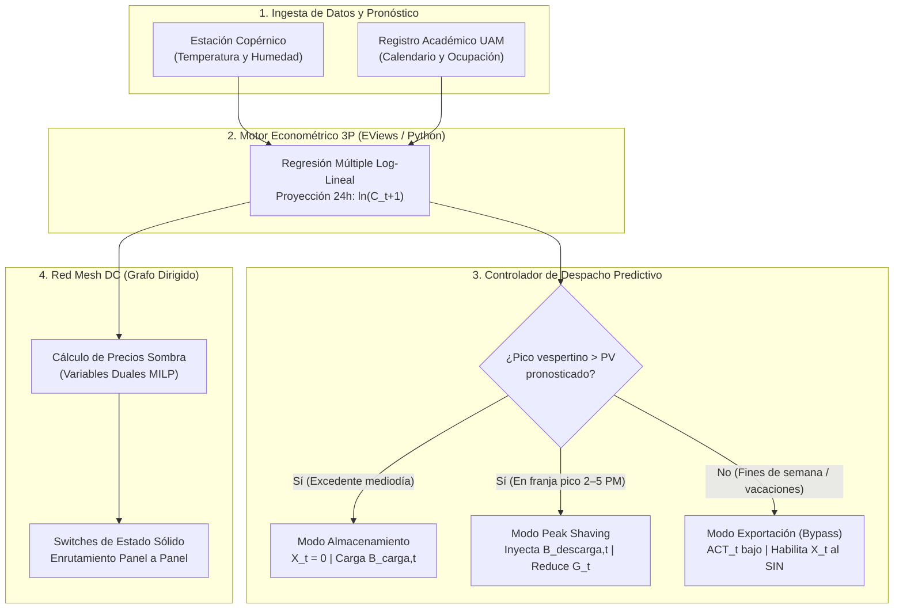

# ☀️ SolarNexus-EDA-UAM

### Motor de Despacho Energético Predictivo, *Peak Shaving* y Red Mesh DC para el Campus UAM (Managua)

*Transformación del modelo econométrico de punto de cambio para enfriamiento (**3P**) de una herramienta pasiva de auditoría a un **oráculo de despacho en tiempo real**, basado en el whitepaper **"Optimización ambiental sin hardware en el campus UAM (Managua)"**.*

---

## 📑 Tabla de Contenidos

1. [Visión General y Cambio de Paradigma](#-visión-general-y-cambio-de-paradigma)
2. [Ecuaciones de Balance Energético](#-ecuaciones-de-balance-energético)
3. [Arquitectura Integral del Sistema](#-arquitectura-integral-del-sistema)
4. [Motor Econométrico Predictivo (EViews / Python)](#-1-motor-econométrico-predictivo-eviews--python)
5. [Sistema de Baterías Basado en Predicción (Peak Shaving)](#-2-sistema-de-baterías-basado-en-predicción-peak-shaving)
6. [Red Mesh DC: Intercambio Descentralizado (Panel a Panel)](#-3-red-mesh-dc-intercambio-descentralizado-panel-a-panel)
7. [Ciclo Operativo Diario (Horizonte de 24 Horas)](#-ciclo-operativo-diario-horizonte-de-24-horas)
8. [Stack Metodológico y Referencia](#-stack-metodológico-y-referencia)

---

## 🌐 Visión General y Cambio de Paradigma

El modelo econométrico de punto de cambio para enfriamiento (**3P**, por *Three-Parameter Change-Point Model*), utilizado ampliamente como estándar de **ASHRAE**, suele emplearse de forma retrospectiva para auditorías energéticas y líneas base de medición y verificación.

**SolarNexus-EDA-UAM** da un paso adelante al convertir ese modelo estadístico en un **motor de despacho en tiempo real**. En lugar de limitarse a explicar el consumo pasado, la calculadora econométrica opera como un **oráculo predictivo** capaz de anticipar la demanda térmica y eléctrica del campus con **24 horas de antelación**, reconfigurando dinámicamente:

- Cuándo almacenar energía solar en baterías locales.
- Cuándo inyectar almacenamiento interno para recortar picos de demanda (*Peak Shaving*).
- Cuándo exportar excedentes al Sistema Interconectado Nacional (**SIN**).
- Cómo enrutar energía en corriente continua (**DC**) directamente entre pabellones mediante precios sombra internos, evitando pérdidas por conversión centralizada.

> [!IMPORTANT]
> El objetivo central es maximizar la **optimización ambiental y económica del campus UAM** sin requerir expansión masiva de hardware, reduciendo la dependencia de la red en horas pico donde la generación marginal recae en plantas térmicas a búnker.

---

## ⚖️ Ecuaciones de Balance Energético

### Ecuación Base (Auditoría sin Almacenamiento)

La formulación original reconstruye el consumo eléctrico total del campus ($C_t$) en el instante $t$ a partir de tres flujos principales:

$$C_t = G_t + PV_t - X_t$$

### Ecuación Extendida (Despacho Predictivo con Almacenamiento)

Al integrar el subsistema de baterías ($B$) y la lógica de enrutamiento gobernada por el oráculo econométrico, el balance energético del campus se transforma en:

$$C_t = G_t + PV_t + B_{\text{descarga},t} - B_{\text{carga},t} - X_t$$

### Glosario de Variables del Balance

| Símbolo | Variable | Descripción Operativa | Rol en el Despacho |
| :--- | :--- | :--- | :--- |
| $C_t$ | **Consumo Total** | Demanda eléctrica agregada del campus UAM en el periodo $t$. | Variable objetivo proyectada por el oráculo 3P. |
| $G_t$ | **Importación de Red** | Energía comprada al Sistema Interconectado Nacional (SIN). | Se minimiza en horarios de tarifa de máxima demanda. |
| $PV_t$ | **Generación Solar Jaguar** | Producción fotovoltaica local del campus. | Fuente primaria para autoconsumo, carga o intercambio DC. |
| $X_t$ | **Exportación al SIN** | Excedente solar vertido hacia la red nacional. | Condicionada estadísticamente a la ausencia de picos futuros. |
| $B_{\text{carga},t}$ | **Carga de Batería** | Flujo de excedente solar dirigido al banco de baterías. | Se activa al anticipar picos vespertinos ($X_t = 0$). |
| $B_{\text{descarga},t}$ | **Descarga de Batería** | Energía inyectada desde el almacenamiento a la red interna. | Ejecuta *Peak Shaving* durante la franja de máxima demanda. |

---

## 🏗️ Arquitectura Integral del Sistema

El siguiente diagrama ilustra cómo los datos meteorológicos y académicos alimentan al oráculo econométrico, y cómo sus predicciones gobiernan tanto el despacho de baterías como el enrutamiento descentralizado en la red Mesh DC:

---

## 🔮 1. Motor Econométrico Predictivo (EViews / Python)

El corazón analítico del sistema es un modelo de regresión múltiple calibrado sobre el comportamiento histórico del campus UAM en Managua, combinando física térmica de edificaciones con dinámica de ocupación académica.

### Especificación Matemática del Modelo

Al alimentarse con el pronóstico meteorológico de la **estación Copérnico** y la programación oficial del **registro académico**, el motor proyecta la demanda eléctrica esperada para las próximas **24 horas** mediante la siguiente ecuación:

$$\ln C_{t+1} = \beta_0 + \beta_1 \, CDD_{t+1}(T_b) + \beta_2 \, HUM_{t+1} + \beta_3 \ln ACT_{t+1} + \beta_4 \ln AREA_{t+1} + \varepsilon_{t+1}$$

### Desglose de Variables Explicativas

| Variable | Significado | Fuente de Datos | Función en el Modelo |
| :--- | :--- | :--- | :--- |
| $CDD_{t+1}(T_b)$ | **Grados-día de enfriamiento** (*Cooling Degree Days*) respecto a la temperatura base $T_b$. | Estación Copérnico | Captura la carga térmica sensible provocada por el clima de Managua sobre los sistemas de climatización. |
| $HUM_{t+1}$ | **Humedad relativa** esperada. | Estación Copérnico | Modela la carga latente que incrementa el esfuerzo de deshumidificación de los equipos HVAC. |
| $\ln ACT_{t+1}$ | **Actividad académica** (en escala logarítmica). | Registro Académico | Distingue días lectivos de alta intensidad frente a fines de semana, feriados o vacaciones. |
| $\ln AREA_{t+1}$ | **Área climatizada** activa (en escala logarítmica). | Gestión de Campus / Horarios | Refleja la superficie total de aulas, laboratorios y oficinas bajo refrigeración simultánea. |
| $\varepsilon_{t+1}$ | **Término de error estocástico**. | Residuo del modelo | Permite evaluar la incertidumbre estadística de la predicción antes de autorizar exportaciones. |

> [!NOTE]
> La especificación semilogarítmica ($\ln C_{t+1}$) permite interpretar $\beta_3$ y $\beta_4$ directamente como **elasticidades** de la demanda respecto a la actividad académica y al área climatizada, mientras $\beta_1$ y $\beta_2$ capturan semielasticidades frente al estrés térmico ambiental.

---

## 🔋 2. Sistema de Baterías Basado en Predicción (*Peak Shaving*)

En un sistema fotovoltaico convencional sin inteligencia predictiva, los excedentes generados al mediodía se exportan automáticamente a la red eléctrica. **SolarNexus-EDA-UAM** reemplaza esa regla estática por un esquema de decisión condicionado por el pronóstico del oráculo econométrico:

### Reglas de Decisión del Controlador

| Régimen Operativo | Condición Disparadora (Oráculo 3P) | Acción sobre Flujos | Impacto Económico y Ambiental |
| :--- | :--- | :--- | :--- |
| **1. Condición de Carga** | Se pronostica un pico de consumo vespertino (ej. **2:00 PM – 5:00 PM**) superior a la capacidad de **Solar Jaguar**. | Bloquea exportación ($X_t = 0$) y desvía el excedente del mediodía a $B_{\text{carga},t}$. | Reserva energía limpia local en lugar de cederla a bajo valor marginal. |
| **2. Condición de Descarga (*Peak Shaving*)** | El campus entra en la ventana del pico vespertino pronosticado. | Inyecta $B_{\text{descarga},t}$ directamente a la red interna del campus. | Evita comprar $G_t$ en tarifa de máxima demanda, desplazando generación térmica a **búnker**. |
| **3. Condición de Exportación** | El modelo asegura estadísticamente ausencia de picos (ej. fines de semana o vacaciones detectados por $ACT_t$). | Se puentea la batería ($B_{\text{carga},t} = B_{\text{descarga},t} = 0$) y se habilita $X_t$. | Evita ciclado innecesario de baterías y monetiza el excedente en el SIN. |

> [!TIP]
> Al evitar la compra de $G_t$ durante la franja de máxima demanda vespertina, el campus reduce simultáneamente los cargos por potencia pico en su factura eléctrica y las emisiones asociadas al despacho marginal de generadores térmicos a búnker en la red nacional.

---

## 🕸️ 3. Red Mesh DC: Intercambio Descentralizado (Panel a Panel)

En una arquitectura solar tradicional, la energía generada en un edificio debe viajar hasta un inversor central, convertirse a corriente alterna (AC) y distribuirse de regreso a los pabellones consumidores, incurriendo en **pérdidas por eficiencia térmica y doble conversión**.

**SolarNexus-EDA-UAM** elimina este cuello de botella modelando los pabellones del campus como **nodos en un grafo dirigido** interconectados mediante una **Red Mesh DC**.

### Mecanismo de Operación Descentralizada

1. **Topología de Micro-Red (Panel a Panel):**
   Los edificios intercambian corriente continua (**DC**) de manera directa. Por ejemplo, si el **Edificio Copérnico** presenta un excedente solar momentáneo mientras el **Pabellón C** experimenta una alta carga térmica por climatización, la energía fluye directamente de panel a panel a través de micro-inversores locales acoplados a la batería, sin transitar por la unidad central.

2. **Precios Sombra Internos (Variables Duales MILP):**
   El sistema reutiliza la lógica de **variables duales (precios sombra)** derivada del modelo de Programación Lineal Entera Mixta (**MILP**). En tiempo real, el algoritmo asigna un **"precio de congestión"** ($\lambda_i$) a cada nodo de la red según su balance local entre generación, carga térmica y capacidad de enlace.

3. **Regla de Enrutamiento por Switches de Estado Sólido:**
   En cada intervalo de control, el algoritmo evalúa la condición de optimalidad:

   $$\text{Costo}_{\text{transferencia}}(i \to j) < \text{Costo}_{\text{ciclado}}(\text{Batería Principal / Inversor Central})$$

   - Si el **precio sombra** de transferir energía hacia el nodo vecino es menor que el costo de ciclar esa energía pasándola por la batería principal o el inversor central, los **switches de estado sólido** cierran el enlace DC y enrutan la energía directamente entre edificios.

---

## 🕒 Ciclo Operativo Diario (Horizonte de 24 Horas)

| Franja Horaria / Escenario | Estado del Oráculo 3P | Comportamiento de Batería ($B$) | Comportamiento Red Mesh DC | Exportación ($X_t$) |
| :--- | :--- | :--- | :--- | :--- |
| **Mañana** (07:00 – 11:00) | Actualiza $\ln C_{t+1}$ con pronóstico de Copérnico y $ACT_{t+1}$. | En espera o carga suave según excedente local. | Balanceo local entre pabellones con clases tempranas. | $X_t = 0$ (prioridad autoconsumo). |
| **Mediodía** (11:00 – 14:00) | Confirma pico vespertino por alto $CDD$ y $ACT$. | **Carga activa** ($B_{\text{carga},t} > 0$) absorbiendo excedente de Solar Jaguar. | Enrutamiento directo DC si un pabellón presenta déficit puntual. | Bloqueada ($X_t = 0$). |
| **Franja Vespertina** (14:00 – 17:00) | Demanda proyectada supera la capacidad de $PV_t$. | **Descarga / *Peak Shaving*** ($B_{\text{descarga},t} > 0$) reduciendo $G_t$. | Prioriza nodos con mayor precio sombra de congestión térmica. | $X_t = 0$. |
| **Fines de Semana / Vacaciones** | $ACT_t$ mínimo; ausencia estadística de picos. | **Puenteada** (sin desgaste por ciclado innecesario). | Mantenimiento de cargas base mínimas. | **Habilitada** ($X_t > 0$ hacia el SIN). |

---

## 🛠️ Stack Metodológico y Referencia

- **Modelado Econométrico:** EViews / Python (Estimación 3P ASHRAE y regresión múltiple log-lineal).
- **Optimización y Precios Sombra:** Formulación MILP (*Mixed-Integer Linear Programming*) para extracción de variables duales nodales.
- **Fuentes de Telemetría y Contexto:** Estación meteorológica **Copérnico**, **Registro Académico UAM** y planta fotovoltaica **Solar Jaguar**.
- **Documento Base:** *Whitepaper: Optimización ambiental sin hardware en el campus UAM (Managua)*.