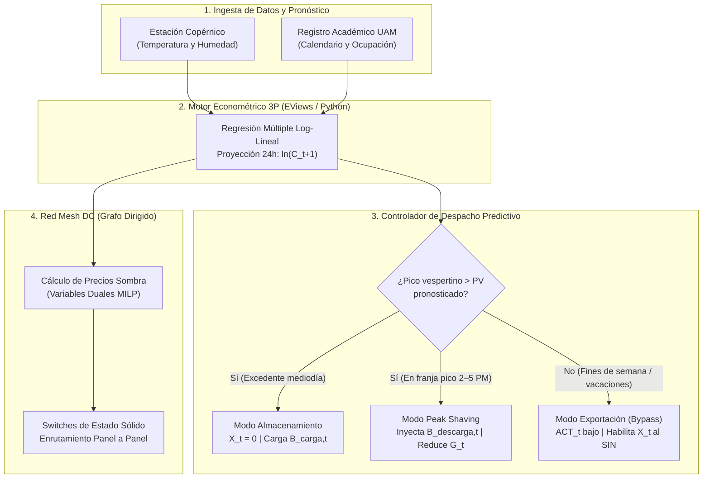
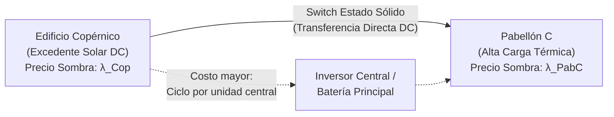

<div align="center">

# ☀️ SolarNexus-EDA-UAM

### Motor de Despacho Energético Predictivo, *Peak Shaving* y Red Mesh DC para el Campus UAM (Managua)


*Transformación del modelo econométrico de punto de cambio para enfriamiento (**3P**) de una herramienta pasiva de auditoría a un **oráculo de despacho en tiempo real**, basado en el whitepaper **"Optimización ambiental sin hardware en el campus UAM (Managua)"**.*

</div>

---

## 📑 Tabla de Contenidos

1. [Visión General y Cambio de Paradigma](#-visión-general-y-cambio-de-paradigma)
2. [Ecuaciones de Balance Energético](#-ecuaciones-de-balance-energético)
3. [Arquitectura Integral del Sistema](#-arquitectura-integral-del-sistema)
4. [Motor Econométrico Predictivo (EViews / Python)](#-1-motor-econométrico-predictivo-eviews--python)
5. [Sistema de Baterías Basado en Predicción (Peak Shaving)](#-2-sistema-de-baterías-basado-en-predicción-peak-shaving)
6. [Red Mesh DC: Intercambio Descentralizado (Panel a Panel)](#-3-red-mesh-dc-intercambio-descentralizado-panel-a-panel)
7. [Ciclo Operativo Diario (Horizonte de 24 Horas)](#-ciclo-operativo-diario-horizonte-de-24-horas)
8. [Stack Metodológico y Referencia](#-stack-metodológico-y-referencia)

---

## 🌐 Visión General y Cambio de Paradigma

El modelo econométrico de punto de cambio para enfriamiento (**3P**, por *Three-Parameter Change-Point Model*), utilizado ampliamente como estándar de **ASHRAE**, suele emplearse de forma retrospectiva para auditorías energéticas y líneas base de medición y verificación.

**SolarNexus-EDA-UAM** da un paso adelante al convertir ese modelo estadístico en un **motor de despacho en tiempo real**. En lugar de limitarse a explicar el consumo pasado, la calculadora econométrica opera como un **oráculo predictivo** capaz de anticipar la demanda térmica y eléctrica del campus con **24 horas de antelación**, reconfigurando dinámicamente:

- Cuándo almacenar energía solar en baterías locales.
- Cuándo inyectar almacenamiento interno para recortar picos de demanda (*Peak Shaving*).
- Cuándo exportar excedentes al Sistema Interconectado Nacional (**SIN**).
- Cómo enrutar energía en corriente continua (**DC**) directamente entre pabellones mediante precios sombra internos, evitando pérdidas por conversión centralizada.

> [!IMPORTANT]
> El objetivo central es maximizar la **optimización ambiental y económica del campus UAM** sin requerir expansión masiva de hardware, reduciendo la dependencia de la red en horas pico donde la generación marginal recae en plantas térmicas a búnker.

---

## ⚖️ Ecuaciones de Balance Energético

### Ecuación Base (Auditoría sin Almacenamiento)

La formulación original reconstruye el consumo eléctrico total del campus ($C_t$) en el instante $t$ a partir de tres flujos principales:

$$C_t = G_t + PV_t - X_t$$

### Ecuación Extendida (Despacho Predictivo con Almacenamiento)

Al integrar el subsistema de baterías ($B$) y la lógica de enrutamiento gobernada por el oráculo econométrico, el balance energético del campus se transforma en:

$$C_t = G_t + PV_t + B_{\text{descarga},t} - B_{\text{carga},t} - X_t$$

### Glosario de Variables del Balance

| Símbolo | Variable | Descripción Operativa | Rol en el Despacho |
| :--- | :--- | :--- | :--- |
| $C_t$ | **Consumo Total** | Demanda eléctrica agregada del campus UAM en el periodo $t$. | Variable objetivo proyectada por el oráculo 3P. |
| $G_t$ | **Importación de Red** | Energía comprada al Sistema Interconectado Nacional (SIN). | Se minimiza en horarios de tarifa de máxima demanda. |
| $PV_t$ | **Generación Solar Jaguar** | Producción fotovoltaica local del campus. | Fuente primaria para autoconsumo, carga o intercambio DC. |
| $X_t$ | **Exportación al SIN** | Excedente solar vertido hacia la red nacional. | Condicionada estadísticamente a la ausencia de picos futuros. |
| $B_{\text{carga},t}$ | **Carga de Batería** | Flujo de excedente solar dirigido al banco de baterías. | Se activa al anticipar picos vespertinos ($X_t = 0$). |
| $B_{\text{descarga},t}$ | **Descarga de Batería** | Energía inyectada desde el almacenamiento a la red interna. | Ejecuta *Peak Shaving* durante la franja de máxima demanda. |

---

## 🏗️ Arquitectura Integral del Sistema

El siguiente diagrama ilustra cómo los datos meteorológicos y académicos alimentan al oráculo econométrico, y cómo sus predicciones gobiernan tanto el despacho de baterías como el enrutamiento descentralizado en la red Mesh DC:



---

## 🔮 1. Motor Econométrico Predictivo (EViews / Python)

El corazón analítico del sistema es un modelo de regresión múltiple calibrado sobre el comportamiento histórico del campus UAM en Managua, combinando física térmica de edificaciones con dinámica de ocupación académica.

### Especificación Matemática del Modelo

Al alimentarse con el pronóstico meteorológico de la **estación Copérnico** y la programación oficial del **registro académico**, el motor proyecta la demanda eléctrica esperada para las próximas **24 horas** mediante la siguiente ecuación:

$$\ln C_{t+1} = \beta_0 + \beta_1 \, CDD_{t+1}(T_b) + \beta_2 \, HUM_{t+1} + \beta_3 \ln ACT_{t+1} + \beta_4 \ln AREA_{t+1} + \varepsilon_{t+1}$$

### Desglose de Variables Explicativas

| Variable | Significado | Fuente de Datos | Función en el Modelo |
| :--- | :--- | :--- | :--- |
| $CDD_{t+1}(T_b)$ | **Grados-día de enfriamiento** (*Cooling Degree Days*) respecto a la temperatura base $T_b$. | Estación Copérnico | Captura la carga térmica sensible provocada por el clima de Managua sobre los sistemas de climatización. |
| $HUM_{t+1}$ | **Humedad relativa** esperada. | Estación Copérnico | Modela la carga latente que incrementa el esfuerzo de deshumidificación de los equipos HVAC. |
| $\ln ACT_{t+1}$ | **Actividad académica** (en escala logarítmica). | Registro Académico | Distingue días lectivos de alta intensidad frente a fines de semana, feriados o vacaciones. |
| $\ln AREA_{t+1}$ | **Área climatizada** activa (en escala logarítmica). | Gestión de Campus / Horarios | Refleja la superficie total de aulas, laboratorios y oficinas bajo refrigeración simultánea. |
| $\varepsilon_{t+1}$ | **Término de error estocástico**. | Residuo del modelo | Permite evaluar la incertidumbre estadística de la predicción antes de autorizar exportaciones. |

> [!NOTE]
> La especificación semilogarítmica ($\ln C_{t+1}$) permite interpretar $\beta_3$ y $\beta_4$ directamente como **elasticidades** de la demanda respecto a la actividad académica y al área climatizada, mientras $\beta_1$ y $\beta_2$ capturan semielasticidades frente al estrés térmico ambiental.

### Validación Estadística: Margen de Error y Criterio de Akaike (AIC)

Para que el oráculo econométrico pueda operar como un controlador de despacho confiable en tiempo real, cada proyección de 24 horas se acompaña de dos métricas estadísticas clave:

#### 1. Probabilidad de Cumplimiento dentro del Margen de Error

El modelo no solo genera una predicción puntual $\widehat{\ln C}_{t+1}$, sino que cuantifica la probabilidad de que el consumo real del campus caiga dentro de un margen de error operativo admisible $\delta$, a partir del error estándar del pronóstico ($\hat{\sigma}_f$) y la distribución de los residuos $\varepsilon_{t+1} \sim \mathcal{N}(0, \sigma^2)$:

$$
P\left(\left|\ln C_{t+1} - \widehat{\ln C}_{t+1}\right| \le \delta\right) = P\left(|Z| \le \frac{\delta}{\hat{\sigma}_{f}}\right) \ge 1 - \alpha
$$

Esta probabilidad actúa como **compuerta de aversión al riesgo**: el sistema solo autoriza decisiones irreversibles (como exportar excedentes al SIN) cuando la probabilidad de cumplimiento dentro del margen de error supera el umbral de confianza exigido (ej. $1 - \alpha = 95\%$).

#### 2. Valor de Akaike (Criterio de Información de Akaike, $\text{AIC}$)

Para seleccionar la especificación óptima del modelo 3P (temperatura base $T_b$, rezagos temporales y combinación de regresores) sin incurrir en sobreajuste (*overfitting*), el motor evalúa el **valor de Akaike**:

$$
\text{AIC} = 2k - 2\ln(\hat{L}) \quad \Longleftrightarrow \quad \text{AIC}_{\text{EViews}} = \frac{-2\ell}{T} + \frac{2k}{T}
$$

donde $k$ representa el número de parámetros estimados, $\hat{L}$ (o $\ell$) la verosimilitud máxima del ajuste y $T$ el tamaño muestral. El pipeline selecciona automáticamente la especificación con **menor valor AIC**, garantizando el equilibrio óptimo entre precisión predictiva y parsimonia.

---

## 🔋 2. Sistema de Baterías Basado en Predicción (*Peak Shaving*)

En un sistema fotovoltaico convencional sin inteligencia predictiva, los excedentes generados al mediodía se exportan automáticamente a la red eléctrica. **SolarNexus-EDA-UAM** reemplaza esa regla estática por un esquema de decisión condicionado por el pronóstico del oráculo econométrico y su intervalo de confianza:

### Reglas de Decisión del Controlador

| Régimen Operativo | Condición Disparadora (Oráculo 3P) | Acción sobre Flujos | Impacto Económico y Ambiental |
| :--- | :--- | :--- | :--- |
| **1. Condición de Carga** | Se pronostica un pico de consumo vespertino (ej. **2:00 PM – 5:00 PM**) superior a la capacidad de **Solar Jaguar** (o la probabilidad fuera del margen de error implica riesgo de déficit). | Bloquea exportación ($X_t = 0$) y desvía el excedente del mediodía a $B_{\text{carga},t}$. | Reserva energía limpia local en lugar de cederla a bajo valor marginal. |
| **2. Condición de Descarga (*Peak Shaving*)** | El campus entra en la ventana del pico vespertino pronosticado. | Inyecta $B_{\text{descarga},t}$ directamente a la red interna del campus. | Evita comprar $G_t$ en tarifa de máxima demanda, desplazando generación térmica a **búnker**. |
| **3. Condición de Exportación** | El modelo (seleccionado por mínimo **AIC**) asegura con probabilidad $P(|\varepsilon_{t+1}| \le \delta) \ge 1 - \alpha$ la ausencia de picos (ej. fines de semana o vacaciones detectados por $ACT_t$). | Se puentea la batería ($B_{\text{carga},t} = B_{\text{descarga},t} = 0$) y se habilita $X_t$. | Evita ciclado innecesario de baterías y monetiza el excedente en el SIN. |

> [!TIP]
> Al evitar la compra de $G_t$ durante la franja de máxima demanda vespertina, el campus reduce simultáneamente los cargos por potencia pico en su factura eléctrica y las emisiones asociadas al despacho marginal de generadores térmicos a búnker en la red nacional.

---

## 🕸️ 3. Red Mesh DC: Intercambio Descentralizado (Panel a Panel)

En una arquitectura solar tradicional, la energía generada en un edificio debe viajar hasta un inversor central, convertirse a corriente alterna (AC) y distribuirse de regreso a los pabellones consumidores, incurriendo en **pérdidas por eficiencia térmica y doble conversión**.

**SolarNexus-EDA-UAM** elimina este cuello de botella modelando los pabellones del campus como **nodos en un grafo dirigido** interconectados mediante una **Red Mesh DC**.



### Mecanismo de Operación Descentralizada

#### 1. Topología de Micro-Red (Panel a Panel)

Los edificios intercambian corriente continua (**DC**) de manera directa. Por ejemplo, si el **Edificio Copérnico** presenta un excedente solar momentáneo mientras el **Pabellón C** experimenta una alta carga térmica por climatización, la energía fluye directamente de panel a panel a través de micro-inversores locales acoplados a la batería, sin transitar por la unidad central.

#### 2. Precios Sombra Internos (Variables Duales MILP)

El sistema reutiliza la lógica de **variables duales (precios sombra)** derivada del modelo de Programación Lineal Entera Mixta (**MILP**). En tiempo real, el algoritmo asigna un **"precio de congestión"** ($\lambda_i$) a cada nodo de la red según su balance local entre generación, carga térmica y capacidad de enlace.

#### 3. Regla de Enrutamiento por Switches de Estado Sólido

En cada intervalo de control, el algoritmo evalúa la condición de optimalidad:

$$
\text{Costo}_{\text{transferencia}}(i \to j) < \text{Costo}_{\text{ciclado}}(\text{Batería Principal / Inversor Central})
$$

Si el **precio sombra** de transferir energía hacia el nodo vecino es menor que el costo de ciclar esa energía pasándola por la batería principal o el inversor central, los **switches de estado sólido** cierran el enlace DC y enrutan la energía directamente entre edificios.

---

## 🕒 Ciclo Operativo Diario (Horizonte de 24 Horas)

| Franja Horaria / Escenario | Estado del Oráculo 3P | Comportamiento de Batería ($B$) | Comportamiento Red Mesh DC | Exportación ($X_t$) |
| :--- | :--- | :--- | :--- | :--- |
| **Mañana** (07:00 – 11:00) | Actualiza $\ln C_{t+1}$ con pronóstico de Copérnico y $ACT_{t+1}$. | En espera o carga suave según excedente local. | Balanceo local entre pabellones con clases tempranas. | $X_t = 0$ (prioridad autoconsumo). |
| **Mediodía** (11:00 – 14:00) | Confirma pico vespertino por alto $CDD$ y $ACT$. | **Carga activa** ($B_{\text{carga},t} > 0$) absorbiendo excedente de Solar Jaguar. | Enrutamiento directo DC si un pabellón presenta déficit puntual. | Bloqueada ($X_t = 0$). |
| **Franja Vespertina** (14:00 – 17:00) | Demanda proyectada supera la capacidad de $PV_t$. | **Descarga / *Peak Shaving*** ($B_{\text{descarga},t} > 0$) reduciendo $G_t$. | Prioriza nodos con mayor precio sombra de congestión térmica. | $X_t = 0$. |
| **Fines de Semana / Vacaciones** | $ACT_t$ mínimo; ausencia estadística de picos. | **Puenteada** (sin desgaste por ciclado innecesario). | Mantenimiento de cargas base mínimas. | **Habilitada** ($X_t > 0$ hacia el SIN). |

---

## 🛠️ Stack Metodológico y Referencia

- **Modelado Econométrico:** EViews / Python (Estimación 3P ASHRAE y regresión múltiple log-lineal).
- **Optimización y Precios Sombra:** Formulación MILP (*Mixed-Integer Linear Programming*) para extracción de variables duales nodales.
- **Fuentes de Telemetría y Contexto:** Estación meteorológica **Copérnico**, **Registro Académico UAM** y planta fotovoltaica **Solar Jaguar**.
- **Documento Base:** *Whitepaper: Optimización ambiental sin hardware en el campus UAM (Managua)*.
---

## 🚀 Puesta en marcha (bases del sistema)

El repositorio incluye ya una primera implementación en Python de los cuatro bloques de la arquitectura. Por ahora funciona con **datos sintéticos** generados con el propio modelo 3P; el siguiente paso es conectarla a las series reales de Copérnico, el registro académico y Solar Jaguar.

```bash
python -m pip install -e ".[dev]"
python -m solarnexus                  # pronóstico + despacho de un día laborable
python -m solarnexus --dia finde      # día de fin de semana (régimen de exportación)
python -m pytest                      # pruebas

# Web (API FastAPI + página): http://127.0.0.1:8000
python -m pip install -e ".[web]"
solarnexus-web
```

### Web: indicadores, análisis entre periodos y despacho

La web (`src/solarnexus/web/`) tiene tres partes:

1. **Indicadores de sostenibilidad entre periodos**: participación de Solar Jaguar en la matriz eléctrica, intensidad energética (kWh/m²/año), CO₂ evitado, excedente inyectado al SIN, comunidad UAM y emisiones per cápita y totales, con los valores oficiales 2024–2025 (`src/solarnexus/indicadores_uam.json`). Se pueden editar y añadir periodos desde la propia página.
2. **Análisis econométrico entre dos rangos de fechas**: estima el modelo 3P en cada periodo con la misma $T_b$ (mínimo AIC sobre los datos conjuntos) y muestra el **test de Chow**, la diferencia de cada coeficiente con su p-valor, el AIC de un modelo común frente a modelos separados y el **ahorro normalizado**: el consumo que el periodo B habría tenido con el modelo de A, frente al real.
3. **Despacho predictivo de un día**: entrena el oráculo con los datos anteriores a la fecha elegida y planifica la batería hora a hora.

Arranca con un año sintético (vacaciones y una mejora de eficiencia del 8 % desde el 1 de agosto de 2026) y admite subir un CSV horario con las columnas `fecha,temperatura,humedad,actividad,area,consumo,pv`. La documentación interactiva de la API está en `/docs`.

### Componente estadístico (rama `estadistica`)

El **análisis econométrico** (elección del modelo, quiebres de Bai-Perron, raíz unitaria, diagnósticos e informe) se hace en **R**, en [`analisis/`](analisis/README.md). El **pronóstico operativo** que se envía al backend sigue en Python, y `analisis/contraste_python.R` comprueba que los dos lenguajes estiman lo mismo.

`src/solarnexus/estadistica/` es la parte que, según el contrato del backend (`docs/API_CONTRACT.md` en la rama `C.santana`), ajusta y valida el modelo econométrico y produce los pronósticos para `POST /api/v1/forecasts`.

```bash
python -m solarnexus.estadistica validar --desde 2026-08-01            # ASHRAE 14, diagnósticos y calibración
python -m solarnexus.estadistica pronosticar --desde 2026-08-01 --salida pronostico.json
python -m solarnexus.estadistica pronosticar --api http://localhost:8000 --enviar   # lee /measurements y envía
```

| Paso | Qué hace |
| :--- | :--- |
| Ajuste | Modelo 3P log-lineal con $T_b$ por mínimo AIC; `--desde` descarta datos anteriores a un quiebre estructural. |
| Diagnósticos | Durbin-Watson, Breusch-Godfrey (24 rezagos), Breusch-Pagan, Jarque-Bera y errores HAC de Newey-West. |
| Validación | Backtest día a día fuera de muestra con criterios ASHRAE Guideline 14 (horario: CV(RMSE) ≤ 30 %, \|NMBE\| ≤ 10 %). |
| Calibración | Factor $k$ que escala $\hat\sigma_f$ para que $P(\lvert e \rvert \le \delta)$ coincida con la frecuencia observada en el backtest. |
| Pronóstico | Regresores por escenario climatológico (misma hora, últimos 28 días del mismo tipo), demanda media con corrección de Duan, salida en hora de Managua (UTC−6). |
| Integración | Cliente HTTP sin dependencias: pagina `GET /api/v1/measurements` (humedad % → fracción, actividad 0 → 0,01) y envía el pronóstico. |
| Clima | Sin datos de Copérnico: `--clima open-meteo` (pronóstico; el backtest usa sus pronósticos pasados), `open-meteo-archivo` (ERA5) o `nasa-power`. Con `--kwp` la PV se estima con la radiación de la fuente. `python -m solarnexus.estadistica clima` descarga la serie a CSV. |
| Historial sin clima | El CSV o la API de la UAM **no necesitan** `temperatura` ni `humedad`: las horas vacías se completan con ERA5 de Open-Meteo, después con sus pronósticos archivados (días recientes) y por último con NASA POWER (`--clima-historial`). Los valores medidos de Copérnico, cuando existan, nunca se sustituyen. |

> [!IMPORTANT]
> Con los datos de demostración, la probabilidad sin calibrar promete ~95–99 % de aciertos dentro del margen, pero en el backtest solo se cumple el 62–70 %: al pronosticar con regresores esperados el modelo es demasiado confiado ($k \approx 2{,}2$–$2{,}4$). Sin calibrar, la compuerta de exportación (≥ 95 %) autorizaría decisiones que no son seguras.

### Estructura del código

| Módulo | Contenido |
| :--- | :--- |
| `src/solarnexus/config.py` | Parámetros: ventana pico (14–17 h), $\alpha$, $\delta$ y rejilla de $T_b$. |
| `src/solarnexus/balance.py` | Ecuaciones de balance base y extendida; `FlujosEnergia` valida que cada intervalo cuadre. |
| `src/solarnexus/oraculo.py` | Modelo 3P log-lineal por MCO, selección de $T_b$ por mínimo AIC (también en escala EViews), error estándar del pronóstico y $P(\lvert Z\rvert \le \delta/\hat\sigma_f)$. |
| `src/solarnexus/despacho.py` | Batería y controlador con los regímenes de carga, *peak shaving*, exportación y autoconsumo. |
| `src/solarnexus/mesh.py` | Red mesh DC como MILP (switches binarios) y precios sombra $\lambda_i$ como duales del PL con los switches fijos. |
| `src/solarnexus/periodos.py` | Comparación entre periodos: test de Chow, diferencias de coeficientes, AIC y ahorro normalizado. |
| `src/solarnexus/indicadores.py` | Indicadores anuales de sostenibilidad y su comparación (puntos porcentuales, variación relativa, mejora). |
| `src/solarnexus/datos.py` | Generador de datos horarios sintéticos con coeficientes conocidos; carga y exportación CSV. |
| `src/solarnexus/web/` | API FastAPI y página web (HTML, CSS y JavaScript con Chart.js). |
| `src/solarnexus/estadistica/` | Validación (ASHRAE 14, diagnósticos, HAC), calibración, pronóstico y cliente del backend. |
| `src/solarnexus/__main__.py` | Demostración de punta a punta. |

> [!NOTE]
> Decisiones de esta primera versión que conviene revisar: intervalos horarios (el $CDD$ se calcula como grados-hora), el excedente que no cabe en la batería durante el régimen de carga se exporta en lugar de desperdiciarse, y, en días con pico previsto, la batería descarga en la ventana pico y después usa lo que le quede para cubrir el déficit de la tarde-noche (`descarga_tras_pico`, desactivable en `Parametros`).
